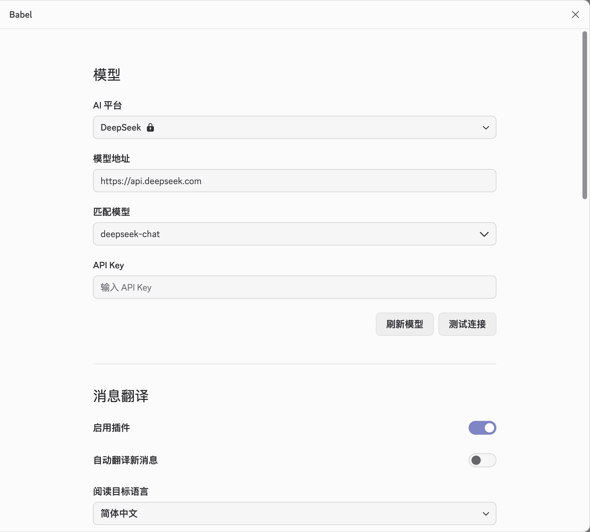
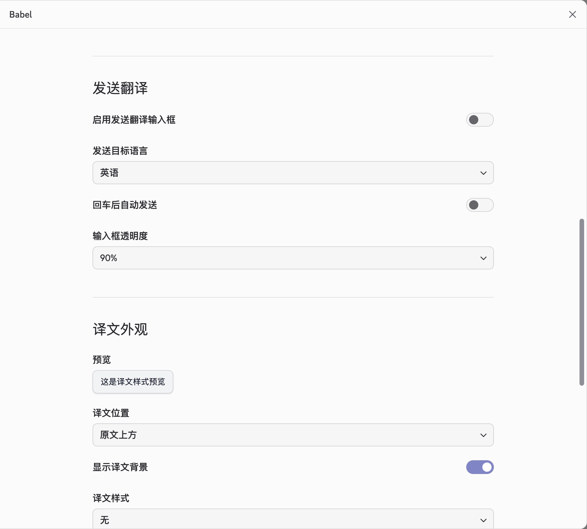

<div align="center">
  
  <h1>Babel</h1>
  <p><strong>AI translation inside Discord, without a full client-mod framework.</strong></p>
  <p>Double-click a message to translate it, translate your own text before sending, or automatically translate new messages.</p>

  <p>
    <a href="https://github.com/itsmaiGe/babel/releases/latest"></a>
    
    <a href="LICENSE"></a>
  </p>

  <p>
    <a href="#-preview">Preview</a> •
    <a href="#-features">Features</a> •
    <a href="#-install">Install</a> •
    <a href="#-how-to-use">How to use</a> •
    <a href="#-faq">FAQ</a> •
    <a href="README.md">简体中文</a>
  </p>
</div>

> Babel is named after the Tower of Babel. The tower failed because people could no
> longer understand one another; this plugin tries to remove that wall inside Discord.

## 📸 Preview

These screenshots are from 0.1.5 and illustrate the basic workflow. Settings have been
rearranged in 0.1.6; the current interface may differ. **Bring your own model service and API key.**

<table>
  <tr>
    <td width="50%" valign="top">
      <p><strong>Model and message translation</strong></p>
      
    </td>
    <td width="50%" valign="top">
      <p><strong>Translation and appearance</strong></p>
      
    </td>
  </tr>
</table>

## ✨ Why Babel?

BetterDiscord and Vencord are great when you want a complete mod framework. Babel is
for people who only want translation.

- **Standalone and focused**: one translator, one small runtime, no plugin framework.
- **Use the AI you already trust**: cloud providers, custom APIs,
  Ollama, or LM Studio.
- **Feels like Discord**: settings reuse Discord's native controls and follow the active
  theme.
- **Translation where you need it**: incoming messages, replies, your own outgoing text,
  and new-message auto-translation.

## 🚀 Features

| Feature | What it does |
| --- | --- |
| Double-click translation | Shows a translation alongside the original. Double-click again to hide it. Quoted previews and reply bodies are translated separately. |
| Translation input box | Translate outgoing text above Discord's composer in a movable, resizable input. Turn off Send on Enter to review the translation in the native composer before sending. |
| Auto-translate new messages | Handles only messages received after you enable it. Skips your target language and leaves channel history alone. |
| Translation styles | Natural, casual, paraphrased, literal, concise, gaming, formal, or your own translation prompt. |
| Appearance | Adjust placement, style, font, emphasis, and colors. Colors have names and previews; Auto follows Discord's theme. |
| Local cache | Saves translations automatically and reuses matching results. Identical concurrent requests are combined to reduce duplicate calls. Clear the cache whenever you need to. |
| Interface language | The plugin and installers follow your system language: English, Simplified Chinese, Traditional Chinese, or Japanese. |
| System proxy | Translation requests use Discord's Electron network stack and follow the system or Discord proxy settings. |

### Supported providers and APIs

| Cloud | Local and custom |
| --- | --- |
| OpenAI, Google Gemini, Claude, DeepSeek, Z.AI, Kimi, OpenRouter | Ollama, LM Studio, and custom endpoints supporting the formats below |

Custom endpoints support **Chat Completions, Responses, and Messages**. OpenAI supports
Chat Completions or Responses. Choose the format documented by your provider; there is
no need to tune generation parameters such as temperature.

Cloud providers require **your own API key and quota**. Ollama and LM Studio usually do
not need a cloud API key. Model availability depends on the model and API format your
service actually supports.

## 📦 Install

Download the latest release:

<p>
  <a href="https://github.com/itsmaiGe/babel/releases/latest/download/Babel-Installer.exe"><strong>Windows: Babel-Installer.exe</strong></a><br />
  <a href="https://github.com/itsmaiGe/babel/releases/latest/download/Babel.Manager.dmg"><strong>macOS: Babel Manager.dmg</strong></a>
</p>

### Windows

1. Download and run **`Babel-Installer.exe`**.
2. Check the detected Discord path. If Discord was moved, enter its installation folder,
   an `app-*` folder, or the full path to `Discord.exe`.
3. Click **Install / Update**. The installer closes the selected Discord instance before installing.
4. After a successful installation, click **Restart Discord** to reopen Discord and close the installer.

Supports **Windows x64**. The installer is unsigned, so SmartScreen may show a warning.
Make sure your download came from this repository's Releases page.

### macOS

1. Download and open **`Babel Manager.dmg`**.
2. Open **Babel Manager**, check the target folder, and click **Install / Update**.
3. After a successful installation, click **Restart Discord** to reopen Discord and close the manager.

Supports **Apple Silicon (M1 or newer)**. The app is not notarized.

If access to Discord data is denied, use **File → Choose Discord folder…**, select the
folder shown in the manager, and retry.

### Finish the installation

Open **Discord Settings → Babel** to configure the plugin. If automatic restart fails,
follow the manager's instructions to fully quit Discord and reopen it. Closing only the
window does not quit the app.

The release includes **SHA256SUMS** to verify the integrity of your downloads.

## 🎮 How to use

1. Open **Discord Settings → Babel**. Under **Model**, choose a provider, enter your API key,
   and select or enter a model.
2. For a custom service, enter its API address and select the **API format** documented by the provider.
3. Click **Test connection** to confirm the configuration can translate, then click **Save** at the bottom.
4. Under **Translation**, choose your reading language, sending language, and translation style, then save.
5. Double-click a message to see its translation in place.

To translate outgoing text, enable **Translation input box**. Turn on **Send on Enter**
to send the result directly, or turn it off to review the translation in Discord's native
composer first. Press **Esc** during translation to cancel and keep your original text.

Enable **Auto-translate new messages** to translate incoming messages automatically.
Existing channel history is left alone.

The footer groups **Save, Discard changes, Open configuration folder, and Clear translation cache**.
Caching is automatic. The interface follows your system language; reading and sending
languages can be chosen separately.

Babel does not overwrite an existing Discord draft. Switching channels or changing the
draft or reply target during translation cancels that send and keeps your original text.

## 🔄 Updating

- Open **Discord Settings → Babel**, scroll to the footer, and click **Check for updates**.
- Download the new installer and run it again. It updates the existing installation in
  place; your settings are kept.
- Discord itself may replace its desktop-core folder during an update. If Babel
  disappears afterward, run the installer again and click **Restart Discord**.

## 🔐 Privacy

- Text you translate is sent to the AI provider you selected. Review that provider's
  privacy policy and use one you trust.
- API keys are encrypted locally using system storage capabilities: Keychain on macOS
  and DPAPI on Windows. Custom endpoint keys are isolated by endpoint address; check
  the key status after changing the address.
- HTTPS is recommended. Remote HTTP requires explicit permission for the current address.
- Babel never reads your Discord token or calls Discord's message endpoints directly;
  translated messages are sent through Discord's native composer.
- Ordinary uninstall keeps settings, encrypted API keys, and translation cache. The explicit cleanup checkbox erases only the selected client’s data after the loader has been restored successfully.

## ❓ FAQ

<details>
<summary><strong>Why did Babel disappear after Discord updated?</strong></summary>

Discord installs updates into a new versioned desktop-core folder. That replaces the
hook Babel used. Run the latest installer again and click **Restart Discord**. Babel does
not keep a background process running to reinstall itself.

</details>

<details>
<summary><strong>Why can a Discord update break the settings UI?</strong></summary>

Babel stays small by reusing Discord's native interface instead of shipping a second UI
framework. When Discord changes those internal components, Babel may need a compatibility
update. Check the latest release first if controls disappear or dropdowns stop opening.

</details>

<details>
<summary><strong>Can Babel coexist with BetterDiscord?</strong></summary>

The installer preserves an existing BetterDiscord loader, but BetterDiscord may still
show its generic “another client mod” warning. If maximum BetterDiscord stability matters
more than a standalone translator, use one client mod at a time.

</details>

<details>
<summary><strong>Why does translation fail for a model that appears in the list?</strong></summary>

Listing models and generating a translation are separate requests. A listed model may
not be supported by the service's generation endpoint. Check the model ID, API format,
key permissions, and quota, then use **Test connection**.

If you use a proxy or gateway, it must forward the selected API format correctly.
Babel does not guess formats from model names or retry with different formats after an
error. A client-side model selection cannot add missing support to a service.

</details>

<details>
<summary><strong>What should I check when a request fails or times out?</strong></summary>

Follow the error message to check the API address, key, quota, API format, and service
status. For network errors, also check your system proxy or VPN. Retry an occasional
timeout; for repeated failures, verify your configuration with **Test connection** first.

</details>

<details>
<summary><strong>Does uninstalling remove my settings and API keys?</strong></summary>

Ordinary uninstall keeps settings, encrypted API keys, and translations. Saved data is
removed only when you explicitly select the cleanup option in the installer, and only
for the selected Discord client.

</details>

<details>
<summary><strong>Is Babel stable?</strong></summary>

Babel is still an early project and Discord's internal updates can cause regressions.
Please report reproducible problems in [Issues](https://github.com/itsmaiGe/babel/issues).

</details>

<details>
<summary><strong>Development</strong></summary>

```bash
npm ci
npm test
npm run install:mod   # install the current source build
npm run uninstall:mod # remove Babel and keep its saved data
npm run uninstall:mod -- --remove-profile-data # explicitly remove selected saved data
npm run uninstall:mod -- --prune # remove unreferenced payloads; Discord must be closed and no installer running
```

The developer command does not lock the target. Do not run it while the macOS app, the Windows installer, or another developer command is changing the same Discord installation. Overlap is unsupported. After an interruption, run the command again once the other operation has finished.

`npm run build` creates the macOS DMG and requires Xcode Command Line Tools. The Windows
installer is built by GitHub Actions from the pinned Go dependencies in `installer/`.

```powershell
node scripts/prepare-installer-payload.js
cd installer
go mod download
go test ./internal/...
go run github.com/akavel/rsrc@v0.10.2 -ico babel.ico -manifest babel.manifest -o rsrc.syso
$env:CGO_ENABLED="0"
go build -ldflags "-H windowsgui -s -w" -o Babel-Installer.exe .
```

</details>

## License

MIT © [Maige](https://x.com/Samoye)

⭐ If Babel makes Discord easier to understand, consider starring the repository.
